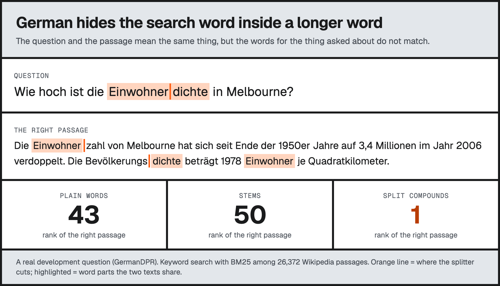
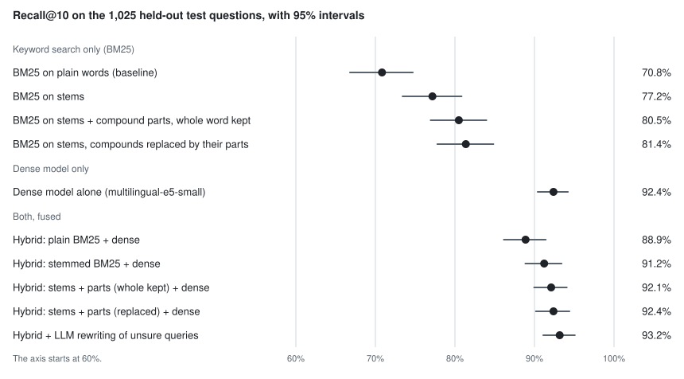
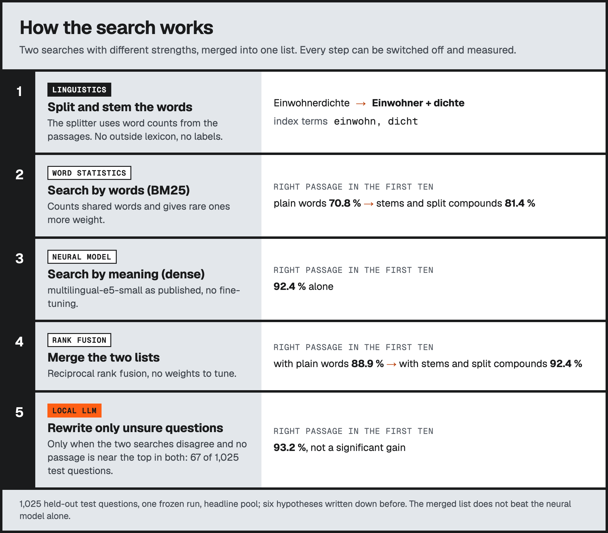

# Compound Search

German glues nouns together. A question asks for the *Einwohnerdichte* of Melbourne; the passage that answers it says *Einwohnerzahl* and
*Bevölkerungsdichte*. A keyword search matches the city's name, but nothing for the thing that is asked about.



This study asks two things:

1. Do the classic fixes for this (stemming and compound splitting) still help keyword search on German text?
2. Is that help still there once a neural search model is added?

It runs on GermanDPR (26,372 German Wikipedia passages) on an 8 GB laptop. The hypotheses and the test rules were fixed in advance, in a
local file; the results come from one search of the 1,025 test questions.

## Results

- **Stemming and compound splitting help keyword search a lot:** +10.5 points (70.8% to 81.4% of the questions have the right passage in the
  first ten).
- **Next to a neural model they still add +3.5 points** (88.9% to 92.4%), in the pool named beforehand. With the pool exactly as GermanDPR
  ships it, stricter for keyword search, it is +2.7 and does not pass the corrected test.
- **But the mix does not beat the neural model alone** (both 92.4%), and rewriting questions with a language model is not shown to help (+0.8, to 93.2%).



Differences are computed before rounding. All tables: [docs/RESULTS.md](docs/RESULTS.md).

*Words used here:* **BM25** = classic keyword search · **dense** = a neural model that compares meanings · **hybrid** = both lists merged ·
**gold passage** = the passage that answers the question · **Recall@10** = how often it is among the first ten · **Holm correction** = a stricter
test because six hypotheses are tested at once.

## How it works



The splitter follows Koehn & Knight (2003): it cuts a word into known words if the parts are frequent enough, so a fixed, frequent compound stays
whole. German linking elements (*Bundes|gericht*, *Sonnen|schein*) are allowed only where they can occur. The word list comes from the passages
themselves. On 100 words that I labelled by hand it reaches F1 0.80; the published splitter HanTa reaches 0.85, too close to rank. I revised eight
of these labels after seeing the scores; on my first labels the scores are 0.73 and 0.77
([details](docs/RESULTS.md#how-good-is-the-splitter-by-itself)).

## The six hypotheses

Written before any system other than plain keyword search existed ([`HYPOTHESES.md`](HYPOTHESES.md)). In points of Recall@10, headline pool.

<!-- BEGIN GENERATED: hypotheses-short -->
|  | Claim | Predicted | Result | Verdict |
|---|---|---|---|---|
| **H1** | Stems or lemmas help BM25 | +1 to +3 | **+6.3** | supported |
| **H2** | Compound splitting helps on top | 0 to +2 | **+4.2** | supported |
| **H3** | The preprocessing gain survives next to a dense model | 0 to +1 (shrinks) | **+3.5** | supported |
| **H4a** | The hybrid beats the dense model alone | a gain | **+0.0** | **not supported** |
| **H4b** | The hybrid beats the best lexical system alone | a gain | **+11.0** | supported |
| **H5** | LLM rewriting of unsure queries helps | about 0 | **+0.8** | **not supported** |
<!-- END GENERATED: hypotheses-short -->

Three of my six predictions were too cautious (H1, H2, H3), one was wrong (H4a), two held (H4b, H5). H3 passes in the headline pool only.

## Three examples

- **A win.** *Einwohnerdichte* against *Einwohnerzahl* and *Bevölkerungsdichte*: rank 43 with plain words, 50 with stems, 1 with split compounds.
- **A loss.** *Straßburg* becomes *Straße* + *Burg*, so "Welches Unternehmen betreibt die Straßenbahn in Straßburg?" falls from rank 3 to 12: the
  question now also matches every passage that mentions a street or a castle.
- **Luck.** For "Was versteht man unter NES?" the language model invents "Netzwerk-Energie-System", and the rank still improves from 12 to 7,
  probably because the expansion repeats *NES*.

## Limits

- **One dataset, a small pool.** The questions were written by people who had the passage in front of them; real searches are shorter and messier.
  Among millions of passages the balance may differ.
- **The pool matters.** The main result (H3) holds in the headline pool only, which helps keyword search.
- **One gold passage per question.** Other passages that also answer it count as misses.
- **One neural model, one language model, one prompt,** all small. The neural model has probably read German Wikipedia.
- **The compound labels are one person's,** and were revised once after the scores were known.
- **The hypotheses were fixed in a local file,** not in a public registry; only its dates show the order.

The full list: [docs/RESULTS.md](docs/RESULTS.md#limits).

## Reproduce

```bash
python3.11 -m venv .venv
.venv/bin/pip install -r requirements.txt
.venv/bin/pip install -e . --no-deps

# the data, about 37 MB, checked by SHA-256
.venv/bin/python -I -m compound_search.download --raw data/raw

.venv/bin/python -I -m pytest -q   # a few seconds
./reproduce.sh                     # every stage, about 40 minutes
```

A clean copy with a fresh download gave 33 identical result files. A test looks up every rank, count and example quoted in this README and in
[docs/RESULTS.md](docs/RESULTS.md) in the saved results.

## Sources

- Data: Möller, Risch & Pietsch (2021), *GermanQuAD and GermanDPR: Improving Non-English Question Answering and Passage Retrieval*. `deepset/germandpr`, CC BY 4.0.
- Splitting method: Koehn & Knight (2003), *Empirical Methods for Compound Splitting*, EACL.
- Dense model: Wang et al. (2024), *Multilingual E5 Text Embeddings: A Technical Report*, arXiv:2402.05672.
- Rank fusion: Cormack, Clarke & Büttcher (2009), *Reciprocal Rank Fusion Outperforms Condorcet and Individual Rank Learning Methods*, SIGIR.
- BM25: Robertson & Zaragoza (2009), *The Probabilistic Relevance Framework: BM25 and Beyond*; implementation `bm25s` (Lù, 2024).
- Tools: Snowball German stemmer, `simplemma` (Barbaresi), HanTa (Wartena, 2019).
- Multiple testing: Holm (1979), *A Simple Sequentially Rejective Multiple Test Procedure*.

The code is MIT ([`LICENSE`](LICENSE)). The data is not part of this repository.
